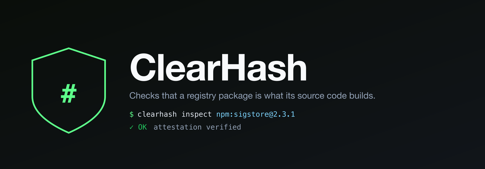
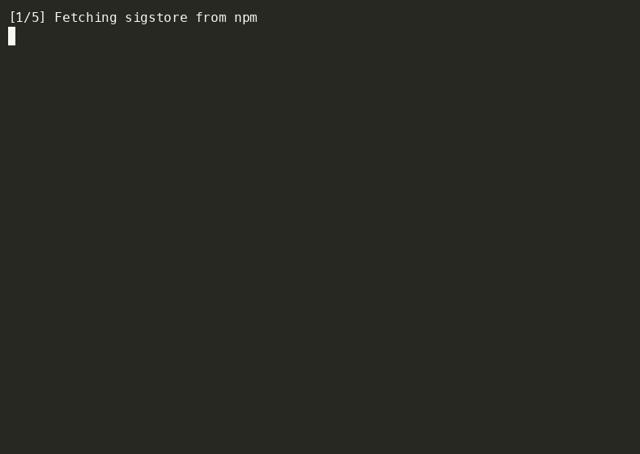
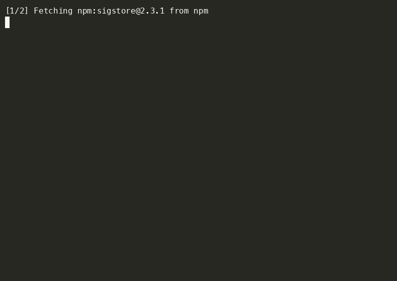

<picture>
  <source media="(prefers-color-scheme: dark)"  srcset="assets/banner-dark.png">
  <source media="(prefers-color-scheme: light)" srcset="assets/banner-light.png">
  
</picture>

[](.github/workflows/ci.yml)
[](https://www.rust-lang.org/)
[](LICENSE)

[](https://www.sigstore.dev/)
[](https://clearhash.vercel.app/)

> **A digital tamper-proof seal for software.** ClearHash verifies that downloaded packages match their exact original source code byte-for-byte.

## 💡 What is ClearHash?

Think of ClearHash like a verified safety seal on food packaging. When developers publish software, bad actors can secretly alter the final download. ClearHash independently rebuilds the software from scratch and checks every byte to prove nobody modified the program between the original source code and your computer.

ClearHash acts as a pre-install gatekeeper. It fetches a package, verifies its SLSA attestation through Sigstore and Rekor, rebuilds it from the attested source commit in an isolated Docker container, and compares the rebuilt file tree against the registry artifact. If anything differs, the install is blocked.

ClearHash answers a question almost nothing in the existing supply chain answers:
**"Is the binary I am about to install actually a build of the source code it claims to be?"**

---

## What it catches

The supply-chain attacks of the last five years (event-stream, ua-parser-js, the
post-install crypto-wallet stealers, xz-utils) all share one shape: the registry tarball
diverges from the source repo. Existing tools verify *who* signed the tarball (Cosign), or
*that the tarball matches itself across mirrors*(Sigstore transparency), but not*whether
the tarball is what the source code would produce*.

ClearHash actually does the rebuild and the comparison.

These historical transcripts show the earlier online rebuild. The pinned source
for `sigstore@2.3.1` omits dependency integrity hashes, so current offline verification
rejects it with exit code 3 (`missing dependency integrity`). `clearhash inspect`
still displays its provenance. CI checks that refusal and tests successful offline
npm/PyPI rebuilds with committed, fully hashed dependency fixtures.

```text
$ clearhash verify npm:sigstore@2.3.1
[1/5] Fetching sigstore from npm
      sha256: 1b5041a35f86125db7f872742502470753fd2e1109521b7dbff8a61d229a03c2
[2/5] Verifying Sigstore attestation
      commit: 46e7056ff991  (workflow: https://github.com/sigstore/sigstore-js/.github/workflows/release.yml@refs/heads/main)
[3/5] Spinning up rebuild container (node:20.11.1-bookworm-slim)
[4/5] Rebuilding from source at commit 46e7056ff991
      built: /tmp/clearhash-rebuild-CuR0xW/rebuilt/out/sigstore-2.3.1.tgz
[5/5] Comparing file trees

✓ MATCH npm:sigstore@2.3.1 tree-hash ec714016d7e4ce742f9aa23b6f16f19cb967bf82b78c343297013dcc268b107e
```

A tampered package gets a different ending. To see what ClearHash actually catches, run
the verify with `--simulate-tamper`, which deliberately modifies the registry-extracted
tree before comparison (the underlying package from npm is clean; the simulation is
clearly announced):

```text
$ clearhash verify --simulate-tamper npm:sigstore@2.3.1
⚠ TAMPER SIMULATION: The registry-extracted tree will be modified before comparison (All mode).
                      The MISMATCH below is real but the registry package is clean.
[1/5] Fetching sigstore from npm
[2/5] Verifying Sigstore attestation
[3/5] Spinning up rebuild container (node:20.11.1-bookworm-slim)
[4/5] Rebuilding from source at commit 46e7056ff991
[5/5] Comparing file trees
      · tampered injectedpayload: dist/.clearhash-tamper-demo.js (added a file that the source rebuild did not produce)
      · tampered contentswap:    dist/index.js                  (appended bytes to an existing file)
      · tampered modeflip:       dist/index.js                  (flipped the executable bit)
      · tampered deletion:       README.md                       (removed a file)

✗ MISMATCH npm:sigstore@2.3.1: 4 difference(s)
    OnlyInRegistry  { path: "dist/.clearhash-tamper-demo.js" }
    ContentDiffers  { path: "dist/index.js" }
    ModeDiffers     { path: "dist/index.js" }
    OnlyInRebuild   { path: "README.md" }
```

The four tamper modes (`injected-payload`, `content-swap`, `mode-flip`, `deletion`, or
`all`) each surface a different diff category. Useful for demos, screenshots, and writing
integration tests against the diff-rendering paths without needing an actual malicious
package.

### Live demos

<details>
<summary><strong>clearhash verify npm:sigstore@2.3.1</strong> — full pipeline (~36s, 4× playback)</summary>



</details>

<details>
<summary><strong>clearhash inspect npm:sigstore@2.3.1</strong> — attestation summary, no rebuild</summary>



</details>

---

## How it works

1. Download the artifact and any published SLSA attestation from npm, PyPI, or crates.io.
2. Check the certificate's Fulcio issuer identity, verify its DSSE signature, authenticate the Rekor checkpoint and Merkle inclusion proof, and confirm that the workflow URI names the source repository.
3. Clone the source repository, check out the attested commit (or the explicitly supplied Cargo source pin), and confirm that `HEAD` matches it.
4. Rebuild the package in a pinned Docker image (`npm pack`, `python -m build --sdist`, or `cargo package`).
5. Extract both archives, drop the metadata the registry adds, and compare their Merkle-hashed file trees. A match exits 0. A mismatch exits 1 with a per-file diff.

The comparison model is **file-tree content hash**, not byte-identical tarball SHA-256.
Strict byte equality is difficult to achieve reliably due to npm package ordering, gzip compression levels, and registry-injected `package.json` metadata variations between `npm pack` invocations. ClearHash normalizes both sides (strips timestamps, normalizes file permissions, and drops registry-injected fields) and compares a cryptographic hash tree over the resulting file tree.

---

## Try it without installing

A hosted instance of the **inspect** endpoint runs at
[**clearhash.vercel.app**](https://clearhash.vercel.app). It performs package retrieval and certificate verification in the cloud. The full **verify** flow runs in the CLI because it requires a local Docker engine to perform safe rebuilds.

```bash
curl 'https://clearhash.vercel.app/api/inspect?package=npm:sigstore@2.3.1'
```

Or paste a package into the form at [`/inspect`](https://clearhash.vercel.app/inspect).

## Install the CLI

Requires Rust 1.88+ and a running Docker daemon (Docker Desktop or OrbStack on macOS).

```bash
git clone https://github.com/Builder106/clear-hash.git
cd clear-hash
cargo install --path crates/clearhash-cli
clearhash --version
```

---

## Use

```bash
# Full pipeline: fetch + attest + rebuild + compare
clearhash verify npm:sigstore@2.3.1

# Just fetch + parse the attestation envelope (no docker required)
clearhash inspect npm:sigstore@2.3.1

# JSON output for CI
clearhash verify npm:sigstore@2.3.1 --json

# Native npm: select the published platform package and its Linux/glibc build target
clearhash verify npm:@example/addon-linux-arm64@1.0.0 --platform linux/arm64

# Cargo: compare against a source repository and full commit SHA you trust
clearhash verify cargo:example@1.0.0 --allow-unattested \
  --source https://github.com/owner/example.git \
  --commit 0123456789abcdef0123456789abcdef01234567

# Keep the temporary folder to inspect a mismatch
clearhash verify npm:foo@1.0.0 --keep-workdir

# Demo: deliberately simulate a modified package to test diff rendering
clearhash verify --simulate-tamper npm:sigstore@2.3.1
clearhash verify --simulate-tamper=content-swap npm:sigstore@2.3.1
```

Cargo requires all three flags: `--allow-unattested`, `--source`, and `--commit`.
The commit must be a full 40-character hexadecimal SHA; branches, tags, and abbreviated
SHAs are rejected. HTTPS, SSH, and local Git repositories are accepted. The selected
crate must belong to the repository's root package or Cargo workspace, with a committed
lockfile compatible with Rust 1.88.0. ClearHash packages the requested name and version
using `cargo package --locked --no-verify`, retaining `.cargo_vcs_info.json` in the
comparison. Other Rust toolchains may produce packaging differences. Cargo packaging
can also re-resolve workspace path dependencies against crates.io, producing lockfile
differences even with `--locked`; these remain visible as mismatches.

A manual match proves that the downloaded crate matches the source you selected. It
does not authenticate the publisher or certify that your source selection is correct.
The source is never inferred from registry metadata. JSON verify results include
`source_repo` and `source_verification` (`manual` or `attested`). Without a source pin,
`--allow-unattested` still exits 2 without rebuilding. Manual pins apply only to Cargo.

For native npm packages, `--platform linux/amd64` or `--platform linux/arm64` selects
an actual Docker execution architecture and the compiler-equipped
`node:24.11.0-bookworm` image (Node 24 ABI, glibc). Docker must support the selected
architecture natively or through configured emulation. Use the exact published
platform package name; ClearHash resolves that release's `dist.tarball` and rejects
incompatible `os`, `cpu`, or `libc` constraints in metadata and in the pinned source.
It does not automatically follow a wrapper package's optional dependencies.

The selected source package must contain `binding.gyp` or an explicit `build` script.
ClearHash invokes bundled `node-gyp` against local Node headers and runs the build
script with errors propagated, then packs with lifecycle hooks disabled. Dependency
installs retain `--ignore-scripts`. Projects that require custom compiler toolchains,
install hooks, or generated platform packages absent from the source need a dedicated
adapter. Native bytes and executable bits remain part of the comparison; compiler,
Node ABI, or libc differences produce mismatches. JSON results include `platform`.
Attestation verification remains mandatory. macOS-only packages such as `fsevents`,
Windows builds, and musl targets require other runners and are rejected by this Linux
Docker implementation. Omitting `--platform` keeps the existing JavaScript rebuild.

npm and PyPI rebuilds install dependencies from host-verified offline caches. After
checking out the pinned source, ClearHash downloads the locked archives over HTTPS,
checks their committed integrity hashes, and mounts them read-only at `/deps`. The
rebuild container uses Docker network mode `none`; a missing dependency fails the
build instead of falling back to the registry. Downloads and image pulls still need
host network access. Each dependency archive is limited to 256 MiB.

For npm, commit a root `package-lock.json` or `npm-shrinkwrap.json` with
`lockfileVersion` 2 or 3 and SHA-256, SHA-384, or SHA-512 SRI hashes for every
external dependency, including development and optional packages. Explicit tarball
URLs must use HTTPS. If a registry URL is omitted, an exact locked name/version
supplies the standard npm registry tarball URL without querying release metadata. Shrinkwrap takes precedence. Workspace links must stay inside the pinned
source; bundled dependencies arrive in their parent tarball. ClearHash seeds the
pinned image's npm cache and runs `npm ci --offline --ignore-scripts`, explicitly
runs an optional build script, and packs with lifecycle hooks disabled. Yarn/pnpm
locks, Git dependencies, external local paths, SHA-1-only hashes, and unlocked
installs are unsupported and fail before rebuilding.

For PyPI sdists, commit a root `pylock.toml` (lock version `1.0`) containing the full
build-tool closure: `build`, its dependencies, the PEP 517 backend, and any dynamic
build requirements. Each package needs wheels with HTTPS `url` and `hashes.sha256`;
the wheel filename comes from `name` or the URL. The supported subset is a wheel
cache, not a general pylock environment resolver: all listed wheels are fetched,
and pip selects compatible wheels in the pinned Python image. Source, VCS, local,
and index-only dependency entries are unsupported. Installation uses a fresh venv
and `PIP_NO_INDEX=1`, `PIP_FIND_LINKS=/deps`, and wheels only, including the isolated
backend environment. Missing or incompatible wheels fail offline. See the
[pinned test lock](crates/clearhash-sandbox/tests/fixtures/pylock.toml) for an example.
Cargo packaging retains its existing network policy.

### Gate npm installs with `clearhash-npm`

`cargo install --path crates/clearhash-cli` installs both `clearhash` and
`clearhash-npm`. With npm 11+ and Docker available, run from a project root:

```bash
clearhash-npm install
clearhash-npm install @scope/package@^1.0.0 --save-dev
clearhash-npm ci

# Optional Unix PATH shim: capture the real npm before adding the shim directory.
export CLEARHASH_REAL_NPM="$(command -v npm)"
mkdir -p "$HOME/.local/share/clearhash-shim"
ln -s "$(command -v clearhash-npm)" "$HOME/.local/share/clearhash-shim/npm"
export PATH="$HOME/.local/share/clearhash-shim:$PATH"
npm install
```

Install aliases (`i`, `add`, etc.) and `ci` aliases pass through the verification
gate. Compound install-and-test commands are rejected; invoke installation and
testing separately. Other commands pass through to npm. Put install options after the command;
`clearhash-npm --help` lists supported options. `CLEARHASH_REAL_NPM` can select an
absolute npm executable; otherwise the shim searches PATH, skipping itself.
The verifier defaults to the sibling `clearhash` binary; an absolute
`CLEARHASH_VERIFY_BIN` overrides it.

For `install`, the shim copies `package.json`, the lockfiles, and `.npmrc` to a
temporary directory and resolves with `--package-lock-only --ignore-scripts`.
For `ci`, it reads the existing lock without resolving. It checks every unique
name/version/integrity entry, including transitive, development, peer and optional
dependencies, using `clearhash verify --expected-integrity <SRI>`. Alias entries
use the actual package name. The verifier checks the downloaded tarball against
the locked SHA-256/384/512 integrity before rebuilding. All entries must match
under the default policy, including optional packages for other platforms.

After verification, the shim checks that the original inputs are unchanged,
publishes the resolved manifest/lock for `install`, and runs `npm ci` against that
lock with lifecycle scripts disabled. This replaces existing `node_modules`.
Resolution or verification rejection leaves project inputs and `node_modules`
untouched; an error during the final npm install can leave npm's normal partial
installation state. npm itself enforces the verified lock's integrity on downloaded
bytes. The lockfile contract follows npm's documented
[`ci` behavior](https://docs.npmjs.com/cli/v11/commands/npm-ci/).

The initial shim supports registry-only projects with v2/v3 npm locks; shrinkwrap
takes precedence. Workspaces, local/Git dependencies, bundled dependencies,
package patches/extensions, global installs, and options that redirect or bypass
the lock are rejected. The existing public npm verifier determines which packages
can match; private-only releases and packages without provenance block by default.
Packages requiring lifecycle scripts or custom native rebuild options need a
separate supported workflow. The shim controls install/ci commands; other npm
commands and direct invocations of the real npm remain outside its gate.

Organizations can explicitly permit verification failures with a JSON policy:

```json
{"default":"block","scopes":{"@legacy-org":"warn","@audit-only":"log"}}
```

Set `CLEARHASH_NPM_POLICY_FILE` to this file's path. Scope rules use the actual
package's scope, including aliases. `block` rejects any nonzero verifier result;
`warn` permits it with a warning; `log` permits it with an audit record. Every
verification emits a JSON record on stderr with the package, policy, match status,
and verifier exit code. Structural lock errors and invalid configuration always
fail closed. Policies should be managed by the organization; this local wrapper
is not a tamper-resistant policy enforcement service.

Shim exit codes are 0 for a successful npm command, 1 for a policy block, and 3
for wrapper/configuration failures. Resolution and install failures preserve npm's
exit status. `warn` and `log` deliberately allow nonmatching packages to install.

## Exit codes

| Code | Meaning |
| ---- | ------------------------------------------------------------- |
| 0    | Tree-hash match. Safe to install. |
| 1    | Tree-hash mismatch or invalid signature. Block installation. |
| 2    | No attestation and no explicitly allowed manual Cargo source pin. |
| 3    | Infrastructure failure (no docker, network down, etc.). |

---

## Ecosystem support

| Ecosystem | Status | Attestation source | Rebuild image |
| --------- | ------------------- | ---------------------------------------------- | ----------------------------- |
| **npm**   | ✅ JavaScript + Linux/glibc native targets | `registry.npmjs.org/-/npm/v1/attestations/...` | `node:24.11.0-bookworm-slim` (JS), `node:24.11.0-bookworm` (native) |
| **PyPI**  | ✅ sdists with locked build wheels | PEP 740 `/integrity/.../provenance` | `python:3.12.2-slim-bookworm` |
| **Cargo** | ✅ end-to-end with manual pin | none (`--allow-unattested --source --commit` required) | `rust:1.88.0-slim-bookworm` |

The Cargo path rebuilds a manually pinned Git source through the same adapter and
comparison pipeline used for attested packages.

---

## What v1 verifies (and what's deferred to v1.1)

**v1 (today):**

- Envelope structural integrity (SLSA v0.2 *and* v1 in-toto statements)
- Full Cosign DSSE signature verification over the in-toto statement using the leaf cert's public key
- X.509 leaf certificate extraction from the Sigstore bundle
- Issuer = Fulcio (rejects bundles with non-Fulcio leaf certs)
- Subject Alternative Name → GitHub Actions workflow URI
- **Cross-check**: workflow URI's `owner/repo` segment matches the attested source repo
- SCT (Signed Certificate Timestamp) verification confirming Fulcio precertificate submission to Certificate Transparency logs
- Full Rekor v1 Merkle inclusion-proof verification against a signed checkpoint, with the logged payload, signature, and certificate bound to the attestation
- Source repo `git clone`+ commit pinning with`HEAD == attested-commit` verification
- Network-disabled npm/PyPI rebuilds with host-fetched, hash-verified dependency caches
- File-tree Merkle compare with per-file diff output

**v1.1 (next):**

- Wheel verification for PyPI (currently only sdists)

Rekor and SCT verification run offline using pinned production public keys from
Sigstore's trusted root (`rekor.sigstore.dev`, `ctfe.sigstore.dev/2022`, and Fulcio
intermediate CA SPKI hashes). Missing proofs, invalid SCTs, invalid checkpoints, and
unknown log keys or entry formats fail verification. Supported entry formats are
`intoto` v0.0.2 and `dsse` v0.0.1; new log keys require a reviewed update.

---

## Architecture

```text
ClearHash/
├── crates/
│   ├── clearhash-cli/             # CLI binary; clap, console, tokio
│   ├── clearhash-web/             # bin + lib; shared Axum router (clearhash_web::app)
│   ├── clearhash-core/            # shared types: PackageRef, ProvenanceClaim, FileTreeHash
│   ├── clearhash-registry/        # reqwest fetchers
│   ├── clearhash-provenance/      # Sigstore + Rekor + envelope parsing
│   ├── clearhash-sandbox/         # bollard Docker orchestration + tree compare
│   └── clearhash-ecosystems/      # EcosystemAdapter trait + npm/pypi/cargo impls
├── api/
│   └── clearhash.rs               # Vercel function; wraps clearhash_web::app with VercelLayer
├── Cargo.toml                     # workspace root *and* a [package] that builds api/clearhash.rs
├── vercel.json                    # Vercel rewrites + runtime config
├── Dockerfile                     # alternative: multi-stage build of clearhash-web binary
└── fly.toml                       # Fly.io deployment config (Docker-based)
```

Every ecosystem-specific quirk lives behind `EcosystemAdapter`. Engine crates depend only
on the trait — adding a new ecosystem is one new file under `clearhash-ecosystems/src/`.

## Deploy your own

The web frontend can deploy two ways. The primary target is **Vercel** — the entire Axum
router runs as a single Rust serverless function via the
[official Vercel Rust runtime](https://vercel.com/docs/functions/runtimes/rust). The
secondary target is any Dockerfile-friendly host (Fly.io, Render, Railway, plain VPS).

### Vercel (recommended)

```bash
# One-time: link this repo to a new Vercel project
vercel link

# Deploy
vercel deploy --prod
```

Vercel auto-detects [vercel.json](vercel.json) and the root `[package]`+`[[bin]]` entries
in [Cargo.toml](Cargo.toml). The function binary is built from [api/clearhash.rs](api/clearhash.rs),
which wraps the shared `clearhash_web::app`router with`vercel_runtime::axum::VercelLayer`
so every route runs through the same handler that powers the local server.

## Docker (Fly.io / Render / Railway)

```bash
# Fly.io (one-time)
flyctl launch --copy-config --no-deploy
flyctl deploy

# Or build + run locally
docker build -t clearhash-web .
docker run --rm -p 8080:8080 clearhash-web
open http://localhost:8080
```

The deployed Docker image is ~158 MB (debian:bookworm-slim + the ~5 MB Rust binary + assets).
No registry credentials, no DB, no secrets — it just proxies the live npm/PyPI APIs.

---

## Caveats and threat model

ClearHash narrows the attack surface from "the registry served you whatever it wanted" to
"the registry served you the artifact that the attested source code produces, built by
the workflow that signed the attestation." Caveats:

1. **The lockfile is part of the trust root.** If `package-lock.json` itself has been

   tampered with at HEAD of the attested commit, the rebuild will faithfully reproduce
   the tampered tree. This is correct: the attestation says "this is what the source
   produces" — the rebuild verifies that claim, not "the source is benign."

2. **Offline rebuilds require complete dependency locks.** npm/PyPI containers have

   no network; missing or unhashed dependencies fail closed. Published dependency
   hashes committed in the pinned source are the trust root for host downloads.
   Cargo packaging still has network access. Offline caches do not make malicious
   source safe or replace container isolation.

3. **Determinism failures look identical to tampering.** If `npm pack` is genuinely

   non-deterministic for a given package (e.g. embeds a hostname), ClearHash flags it
   as a mismatch. The `--keep-workdir` flag is for triaging these cases.

4. **Docker is required.** No daemon, no verification. macOS users: Docker Desktop or

   OrbStack.

---

## Contributing

See [CONTRIBUTING.md](CONTRIBUTING.md).

---

## License

[MIT](LICENSE).
